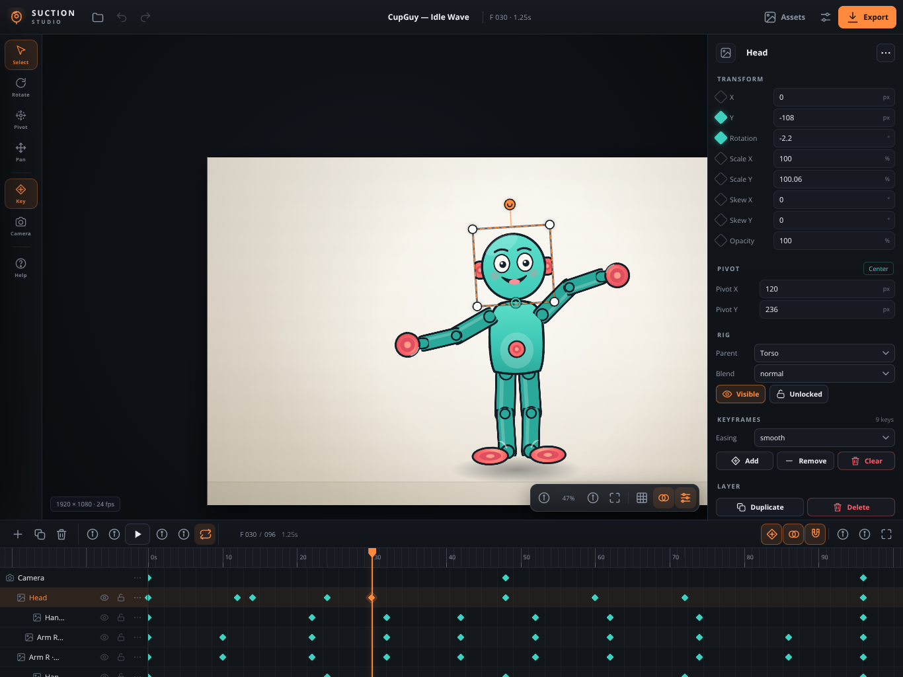

# Suction Studio

A touch-first, cut-out puppet animator for iPad. Build characters out of separate PNG
parts, parent them into a rig, and keyframe transforms on a timeline — then export
video, PNG sequences, stills, WAV audio, or a portable project file.

Built with plain HTML, CSS and JavaScript. No build step, no dependencies, works offline.



---

## Quick start

Open `index.html` directly in a browser, or serve the folder:

```bash
python3 -m http.server 8000
# then visit http://localhost:8000
```

Best experienced on an iPad in landscape with an Apple Pencil or your fingers, but it
works with a mouse and keyboard too.

---

## Features

### Rigging
- **Cut-out puppets** — every layer is a PNG with its own pivot point.
- **Parenting hierarchy** — parts follow their parent (forearm follows arm, hand follows
  forearm). Reparent any part from the inspector; cycles are rejected.
- **Pivot editing** — drag a pivot without moving the artwork. Pivot moves compensate
  every keyframe so the pose is preserved.
- **Null objects** — invisible controllers for grouping.
- **Blend modes** — normal, multiply, screen, overlay, darken, lighten, color-dodge,
  color-burn, hard-light, soft-light, difference, exclusion, hue, saturation, color,
  luminosity.
- **Opacity, scale, skew** — all keyframable.

### Animation
- **Keyframe timeline** — one row per layer plus camera and audio tracks. Drag a
  diamond to slide every key on that frame; scrub the ruler to move the playhead.
- **Auto-key** — pose a part and a keyframe is written at the playhead.
- **Easing per key** — linear, smooth (ease-in-out), ease-in, ease-out, hold, overshoot,
  bounce.
- **Onion skinning** — ghosts the neighbouring *keyframes* (not the neighbouring
  frames, which look identical at 24 fps). Full-frame plates such as a backdrop can be
  excluded per layer.
- **Camera** — pan and zoom, keyframed, with a dashed frame overlay.
- **Playback** — 1–120 fps, loop, scrub, frame stepping, transport controls.
- **Undo / redo** — 80 levels, with keyboard shortcuts.

### Audio
- Import WAV, MP3, OGG, M4A, AAC, FLAC.
- Multiple audio tracks, clips with start / offset / length / gain, mute per track.
- Sample-accurate WebAudio scheduling during playback.
- Offline mixdown to WAV for export.

### Assets & import
- Drag-and-drop or pick PNG, JPG, WEBP, GIF, SVG, AVIF.
- Paste an image straight from the clipboard.
- Asset library drawer with usage counts and one-tap placement.
- Everything is embedded in the project file, so a `.suction.json` is fully portable.

### Export
| Format | Notes |
| --- | --- |
| **Video (WebM / MP4)** | Real-time MediaRecorder capture, optional mixed audio, 25–200% scale, 12–40 Mbps |
| **PNG sequence** | Lossless, optional transparent background, every Nth frame, zipped |
| **Still frame** | Current playhead at up to 4K, optional alpha |
| **WAV** | Full mixed soundtrack, rendered offline |
| **Project** | `.suction.json` with every asset embedded |

### iPad & touch
- Pinch to zoom, two fingers to pan, one finger to pose.
- Corner handles scale, the handle above the box rotates, the teal dot moves the pivot.
- Rail, HUD and timeline are all 44 pt+ touch targets.
- Safe-area aware (notch / home indicator), portrait and landscape.

---

## Interface

```
┌──────────────────────────────────────────────────────────────┐
│ top bar: file · undo · redo · project name · time · export   │
├────┬───────────────────────────────────────┬─────────────────┤
│rail│              stage                    │   inspector     │
│    │        (canvas + HUD)                 │ transform/pivot │
│    │                                       │ rig/keyframes   │
├────┴───────────────────────────────────────┴─────────────────┤
│ toolbar: layers · transport · auto-key · onion · snap · zoom │
│ timeline: camera row, layer rows, audio tracks               │
└──────────────────────────────────────────────────────────────┘
```

- **Rail** — Select, Rotate, Pivot, Pan; Add key, Camera, Help.
- **HUD** (bottom right of the stage) — zoom, fit, grid, onion skin, inspector.
- **Inspector** — transform, pivot, parent, blend, visibility/lock, easing, add/remove
  keys. Collapses to a drawer on narrow screens.
- **Timeline** — scrub on the ruler, drag keys, drag the divider to resize.

---

## Shortcuts

| Key | Action |
| --- | --- |
| `Space` | Play / pause |
| `←` / `→` | Step one frame (`Shift` = 10) |
| `Home` / `End` | Jump to start / end |
| `V` `R` `P` `H` | Select, Rotate, Pivot, Pan tool |
| `K` | Add / remove key at playhead |
| `O` | Toggle onion skin |
| `G` | Toggle grid |
| `+` / `-` | Zoom timeline |
| `0` | Fit timeline |
| `Delete` / `Backspace` | Delete selection |
| `⌘Z` / `⇧⌘Z` (or `⌘Y`) | Undo / redo |
| `⌘S` | Save project |
| `⌘E` | Export dialog |
| `⌘O` | Open project |
| `Esc` | Close menu / dialog / deselect |

---

## Project format

A `.suction.json` file is a single JSON object:

```json
{
  "kind": "suction-studio-project",
  "version": 1,
  "name": "My Scene",
  "settings": { "width": 1920, "height": 1080, "fps": 24, "duration": 96,
                "background": "#e9e3d7", "transparent": false },
  "assets":   { "asset-id": { "id": "...", "name": "...", "type": "image",
                              "src": "data:image/png;base64,…", "w": 240, "h": 240 } },
  "layers":   [ { "id": "head", "name": "Head", "assetId": "...", "parent": "torso",
                  "x": 0, "y": -108, "pivot": { "x": 120, "y": 236 },
                  "keys": { "rotation": [ { "t": 14, "v": 2.4, "e": "smooth" } ] } } ],
  "camera":   { "keys": { "zoom": [ { "t": 0, "v": 100, "e": "linear" } ] } },
  "audioTracks": [ { "id": "...", "name": "Music", "muted": false,
                     "clips": [ { "id": "...", "assetId": "...", "start": 0,
                                  "offset": 0, "duration": 4, "gain": 1 } ] } ]
}
```

### Coordinate spaces

- A layer's `x` / `y` are **relative to its parent's pivot** (parent bone space).
- `pivot` is in the **image's own pixel space** (top-left origin).
- Children inherit the parent's rotation, scale and skew.
- `Model.boneMatrix()` is the pivot frame; `Model.matrix()` is the full image matrix
  (`boneMatrix × translate(-pivot)`), used for drawing and hit testing.

---

## Source layout

```
index.html            shell: top bar, rail, stage, inspector, timeline, roots
css/app.css           design system (graphite + amber), layout, responsive rules
js/util.js            helpers, 2×3 matrix, easing, icons, zip, wav encoder
js/model.js           project schema, rig math, keyframes, interpolation
js/audio.js           WebAudio playback, scheduling, offline mixdown
js/default-project.js the CupGuy demo rig + animation
js/render.js          stage renderer, onion skin, selection handles, hit testing
js/export.js          video / PNG sequence / still / WAV / project export
js/ui.js              all chrome: rail, top bar, timeline, inspector, menus, modals
js/main.js            app controller: state, editing, playback, shortcuts, autosave
```

Load order: `util → model → audio → render → export → default-project → ui → main`.

---

## Browser support

- iPadOS 16+ Safari (video export uses MP4/H.264).
- Chrome / Edge 90+ (video export uses WebM/VP9).
- Firefox: PNG sequence, still, WAV and project export work; video export depends on
  MediaRecorder support.

## Notes

- Autosave lives in IndexedDB (projects embed their assets and can exceed localStorage
  limits). You'll be offered a restore on the next launch.
- Video export runs in real time — keep the tab visible and let it finish.
- For lossless output or transparency, use **PNG Sequence**.
